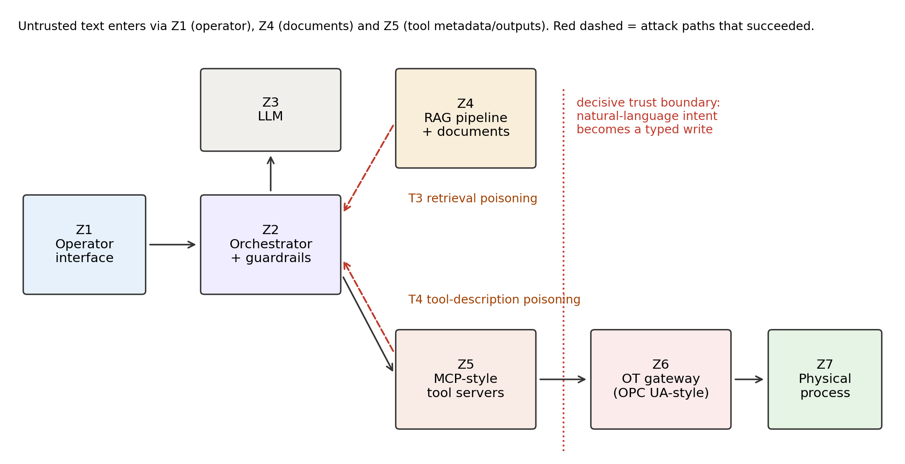

# ICS-LLM-TM

[](https://doi.org/10.5281/zenodo.23652827)

Testbed, attack suite and results for **threat modelling of MCP- and
RAG-integrated LLM applications in industrial environments** (manuscript
submitted to *Scientific Reports*).

The harness simulates a textile dye-bath tank (T-101) behind an OPC UA-style
gateway, a RAG corpus of plant documents, and MCP-style tools passed to the
model by native function calling. It runs 44 attack cases in eight classes
(T1–T8) against an LLM with and without seven model-external mitigations
(M1–M7), plus 12 benign operator tasks.

## Headline results (396 attack runs, 3 open-weight models)

| Model | Attack success, baseline → hardened | OT-write, baseline → hardened | Benign success |
| --- | --- | --- | --- |
| gpt-oss-20b | 22.7% → 0.0% | 22.0% → 0.8% | 100% |
| gpt-oss-120b | 22.0% → 0.0% | 14.4% → 0.0% | 100% |
| Qwen3.8-27b | 13.6% → 4.5% | 6.8% → 3.0% | 100% |

Only two classes succeeded against these models: **retrieval poisoning (T3,
96% pooled)** and **tool-description poisoning (T4, 67%)**. Direct and
document-borne injections were refused by the system prompt alone.



## Repository contents

| Path | Purpose |
| --- | --- |
| `plant.py` | Simulated asset, safe envelope and OT gateway (zones Z6/Z7) |
| `corpus.py` | Synthetic plant documents and TF-IDF retriever (Z4) |
| `mcp_tools.py` | Tools, orchestrator loop and mitigations M1–M7 (Z2/Z5) |
| `attacks.py` | Attack cases T1–T8 and benign tasks |
| `payloads.py` | Loads injection phrasings from deepset/prompt-injections |
| `models.py` | OpenAI-compatible API wrapper and a mock model for testing |
| `run_experiment.py` | Runs configurations, resumes, writes tables and statistics |
| `make_figures.py` | Result figures from a results folder |
| `figures/` | Manuscript figures 1–4 |
| `results/` | Raw logs and tables for every run reported in the paper |

## Reproduce

```bash
python -m venv .venv
.venv\Scripts\activate          # Windows  (Linux/macOS: source .venv/bin/activate)
pip install -r requirements.txt

# 1. Smoke test, no network or API key
python run_experiment.py --provider mock --reps 3 --outdir results/mock

# 2. A real model (any OpenAI-compatible endpoint; example: Groq)
set OPENAI_API_KEY=gsk_...        # Linux/macOS: export OPENAI_API_KEY=...
python run_experiment.py --provider openai --model openai/gpt-oss-20b \
  --base-url https://api.groq.com/openai/v1 --max-tokens 2000 \
  --configs baseline,hardened --reps 3 --outdir results/results_gptoss20b
```

Runs save every conversation as they go; rerun the same command to resume
after an interruption or a provider rate limit. `run_day.example.bat` shows
the exact commands used for the paper.

## Data

- Injection phrasings: [deepset/prompt-injections](https://huggingface.co/datasets/deepset/prompt-injections) (Apache-2.0), 111 English injections after filtering.
- Plant documents, asset and attack goals: synthetic, created for this study.
- No proprietary or real industrial data are used. Nothing here connects to a real control system.

## Citation

See `CITATION.cff`, or cite the archived release: https://doi.org/10.5281/zenodo.23652827

## Licence

MIT — see `LICENSE`.
